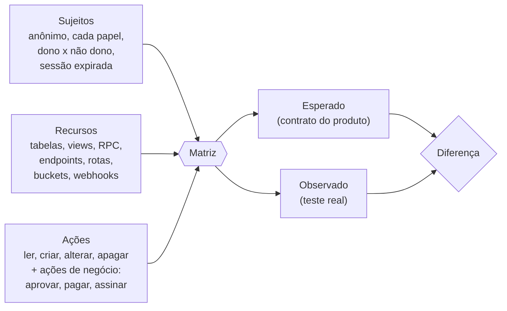
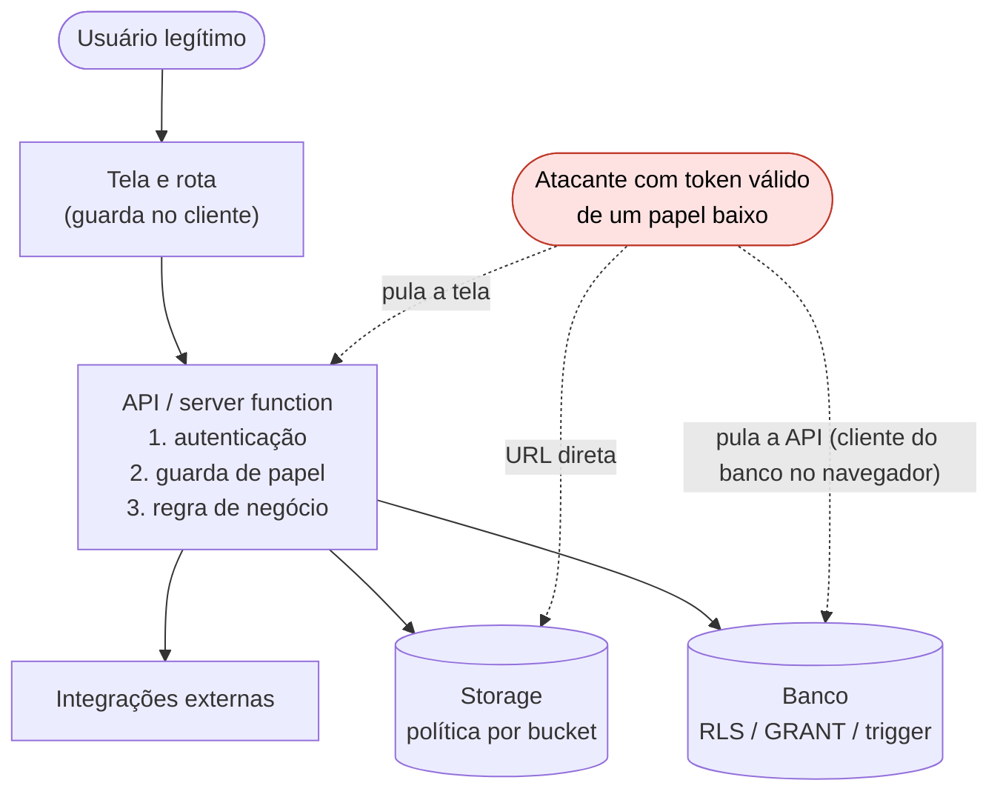
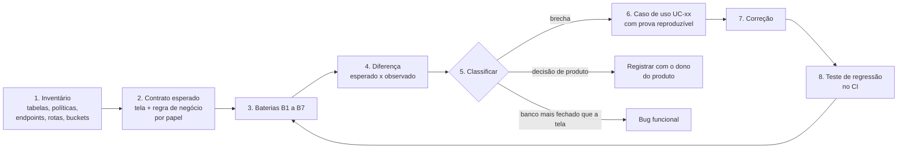
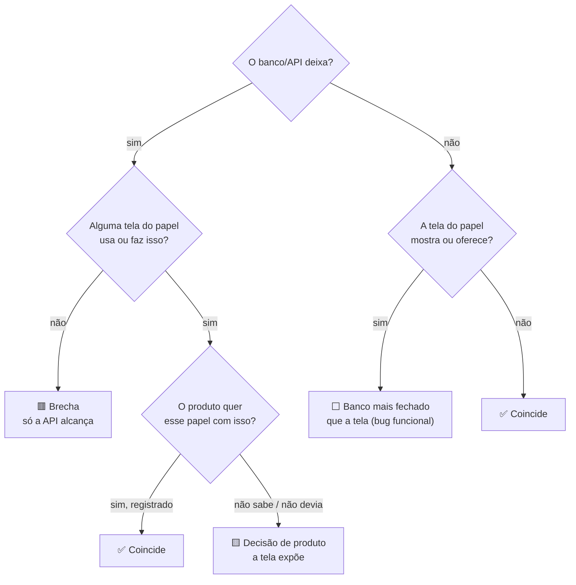

# Matriz de controle de acesso: modelo

Modelo para provar, papel por papel, que cada usuário só lê e altera o que deve. Ele cobre o que o scanner dinâmico (ZAP, nuclei) não enxerga: **Broken Access Control** (OWASP A01), IDOR/BOLA, função liberada para o papel errado, atribuição em massa e regra de negócio burlada por escrita direta.

Copie este arquivo para um **repo privado** do sistema, troque tudo que está entre `<...>` e mantenha o resultado versionado. Este repo é público: aqui fica só o modelo, nunca o resultado.

## Antes de começar

- [ ] Autorização por escrito do dono do sistema, com escopo e janela.
- [ ] Ambiente local ou de homologação, nunca produção. Produção só em leitura e com aprovação explícita.
- [ ] Uma conta de teste por papel, mais uma sem login (anônimo), mais um usuário "dono" vinculado a um registro.
- [ ] Credenciais fora do repo (arquivo ignorado pelo git ou variável de ambiente).
- [ ] Toda escrita de teste roda em transação desfeita, ou em base descartável.
- [ ] Integrações externas (e-mail, chat, assinatura, pagamento) sem token no ambiente de teste.

## O que a matriz responde

Para cada **sujeito** × **recurso** × **ação**: o que o produto diz que pode, e o que o sistema realmente deixa.



## Camadas que precisam ser testadas

A tela esconder um botão não é controle de acesso. Quem ataca chama a API e o banco direto, sem passar pela tela. Teste **cada camada** de forma isolada.



| Camada | Pergunta | Bateria |
|---|---|---|
| Tela/rota | O link escondido também bloqueia a URL? (é conforto, não segurança) | B5 |
| API | Sem login recusa? Papel errado recusa **com entrada válida**? | B3 |
| Regra de negócio | A ação só acontece pelo fluxo que tem as travas? | B4 |
| Banco | Cada papel lê, cria, altera e apaga só o esperado? | B1, B2 |
| Storage | Cada bucket segue o mesmo contrato da tabela que aponta para ele? | B1 |
| Sessão | Logout, troca de papel e token expirado cortam o acesso? | B7 |

## Processo



### 1. Inventário

Liste tudo que um usuário autenticado alcança sem passar pela tela:

- Tabelas e views expostas pela API do banco, com as políticas de cada uma (SELECT, INSERT, UPDATE, DELETE).
- Funções do banco que o papel autenticado ou anônimo pode executar, principalmente `SECURITY DEFINER`.
- Endpoints e server functions, com o papel que a guarda aceita.
- Rotas da interface e o papel que cada uma exige.
- Buckets de arquivos e suas políticas.
- Endpoints públicos (webhooks, formulários, crons) e como se autenticam.

### 2. Contrato esperado

O esperado vem do produto, não do código de segurança. Fontes, nesta ordem:

1. Regra de negócio escrita (épico, card, ADR).
2. O que a tela mostra para cada papel (menu, abas, botões habilitados).
3. Na falta das duas, uma decisão do dono do produto, registrada.

Escreva por papel: que telas abre, que dados vê em cada tela, que ações executa. Isso vira a **Matriz A**.

### 3. Baterias

| Bateria | O que faz | Como |
|---|---|---|
| **B1 Banco** | Cada papel tenta ler, criar, alterar e apagar em cada tabela, view e bucket | Uma transação por tentativa, desfeita no final. Veja a técnica abaixo |
| **B2 Semeadura** | Tabelas vazias e o par dono x não dono | Cria uma linha do usuário "dono" e uma de outra pessoa dentro da mesma transação desfeita |
| **B3 API negativa** | Cada endpoint chamado sem login e com cada papel que a guarda deveria recusar | Entrada **válida**, senão a validação recusa antes da guarda e o teste não prova nada. Ajuste a entrada lendo o erro de validação até chegar na guarda |
| **B4 Casos de escrita** | A ação de negócio feita por fora do fluxo (aprovar etapa de outro papel, marcar pago sem a trava, mudar valor) | SQL ou API direta com o token do papel, em transação desfeita |
| **B5 Telas** | Rota escondida no menu também bloqueia pela URL | Navegar logado com cada papel |
| **B6 DAST autenticado** | Injeção, cabeçalhos, configuração, com sessão | ZAP com login. Para cobrir as chamadas de API, passe a suíte E2E pelo proxy do ZAP e rode o scan ativo no que ela gravou. Depois repita essas chamadas com o token de outro papel |
| **B7 Sessão** | Logout, papel removido, token expirado | Repetir uma chamada autorizada depois de cada evento |

O ZAP sozinho não acha Broken Access Control: ele não sabe o que cada papel deveria ver. Quem acha é a diferença entre a Matriz A e o observado.

#### Técnica B1 para Postgres com RLS (Supabase e parecidos)

Cada tentativa roda num subbloco que sempre termina em erro proposital. O erro desfaz a escrita e a troca de papel, e a mensagem carrega o resultado.

```sql
DO $b$ DECLARE n bigint; BEGIN
  BEGIN
    PERFORM set_config('request.jwt.claims', '{"sub":"<uuid-do-usuario>","role":"authenticated"}', true);
    PERFORM set_config('role', 'authenticated', true);
    WITH u AS (UPDATE public.<tabela> SET <coluna> = <coluna> RETURNING 1) SELECT count(*) INTO n FROM u;
    RAISE EXCEPTION 'OK:%', n;
  EXCEPTION WHEN OTHERS THEN
    RAISE NOTICE 'R|<tabela>|<papel>|update|%|%', SQLSTATE, SQLERRM;
  END;
END $b$;
```

Como ler o código do erro:

| SQLSTATE | Significa |
|---|---|
| `P0001` com `OK:n` | Permitido em `n` linhas (0 = a política esconde tudo) |
| `42501` com "row-level security" | Negado pela política |
| `42501` sem RLS | Negado por GRANT |
| `23xxx` (unique, FK, not null) | **A política deixou passar**; quem barrou foi a constraint |
| Outro (trigger, tipo) | Inconclusivo: ajuste a linha de teste |

Para INSERT, copie uma linha existente com `row_to_json`, troque o `id` e insira com `json_populate_record`. Assim você testa "criar registro de outra pessoa", que é o caso que importa.

Confira contagens antes e depois da rodada para provar que nada mudou.

## Classificação



Regra de ouro: **a tela é a fronteira do que o produto quer mostrar; o banco e a API são a fronteira do que o sistema permite.** Brecha é quando a segunda é maior que a primeira.

## Severidade

| Nível | Critério |
|---|---|
| Crítica | Anônimo ou papel externo lê dado pessoal/financeiro de outros, ou vira admin |
| Alta | Papel interno altera dinheiro, pagamento, aprovação ou decisão de outra área |
| Média | Papel interno lê dado financeiro ou pessoal que nenhuma tela dele mostra; fluxo burlado sem ganho direto |
| Baixa | Metadado, enumeração, informação sem dado sensível |

## Matriz A: telas por papel (contrato)

| Tela / rota | <papel 1> | <papel 2> | <papel 3> | anônimo |
|---|---|---|---|---|
| `<rota>` | ✅ | ✅ só os próprios | ❌ | ❌ |

## Matriz B: recurso × papel × ação

Legenda de cada célula: `L C A X` = ler, criar, alterar, apagar. Exemplo: `L A` lê e altera. `L(próprio)` lê só o que é dele.

| Recurso | Tela que usa | Esperado (tela) | Observado (banco/API) | Situação | Prova |
|---|---|---|---|---|---|
| `<tabela>` | `<rota/aba>` | `<papel>: L` | `<papel>: L A` | 🟥 UC-01 | `<arquivo de resultado>` |

## Matriz C: endpoints

| Endpoint | Papéis aceitos | Sem login | Papéis recusados testados | Resultado |
|---|---|---|---|---|
| `<nome>` | `<papéis>` | recusa | `<papéis>` | todos recusados |

## Matriz D: casos de uso

Um bloco por diferença classificada como brecha:

```markdown
### UC-xx <título curto>

- Ator: <papel>, com token válido
- Pré-condição: <estado>
- Ação: <chamada exata, sem credencial>
- Esperado: <recusa e por quê; quem pode pela tela>
- Observado: <resultado e evidência>
- Severidade: <nível>
- Correção sugerida: <política, guarda ou trigger>
- Regressão: <teste que fica no CI e quebra se voltar>
```

## Pronto quer dizer

- Nenhum 🟥 aberto, ou cada um com dono e prazo.
- Cada 🟨 decidido pelo dono do produto, por escrito.
- Cada UC corrigido tem teste de regressão rodando no CI, em todo PR que mexe em migration, política ou guarda.
- A rodada é reproduzível: scripts no repo privado, credenciais fora dele, data e commit testado anotados.

## O que trocar para cada sistema

- [ ] Lista de papéis e o usuário "dono".
- [ ] Fonte do contrato (épico, telas, regras).
- [ ] Como obter token de cada papel.
- [ ] Como chamar a API (REST, RPC, server function) e como ler o erro de validação.
- [ ] Técnica B1 da sua base (Postgres RLS, ORM, outra).
- [ ] Integrações que precisam ficar sem token no teste.
- [ ] Onde o resultado fica (repo privado) e quem aprova rodar em produção.
